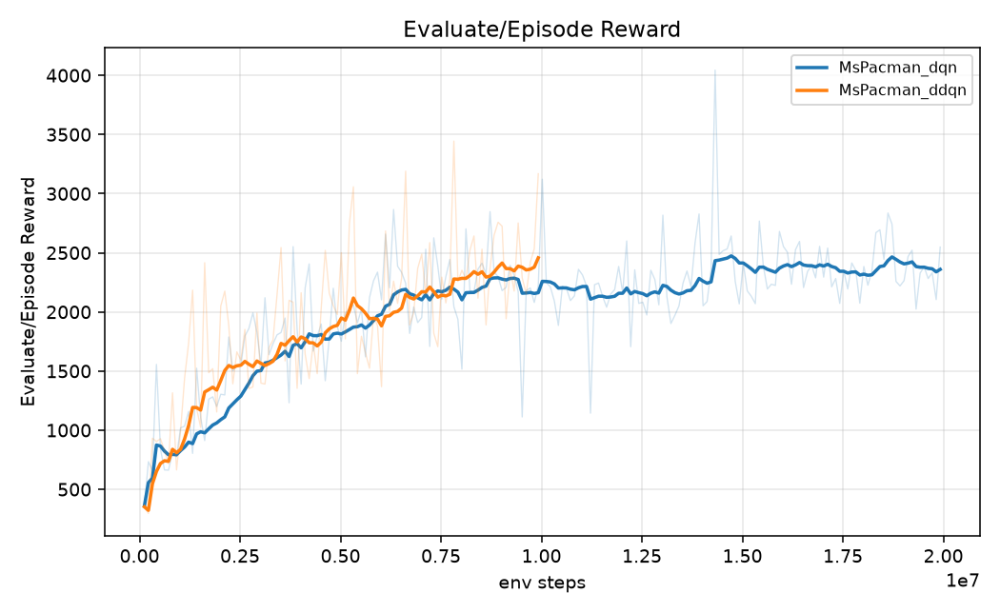
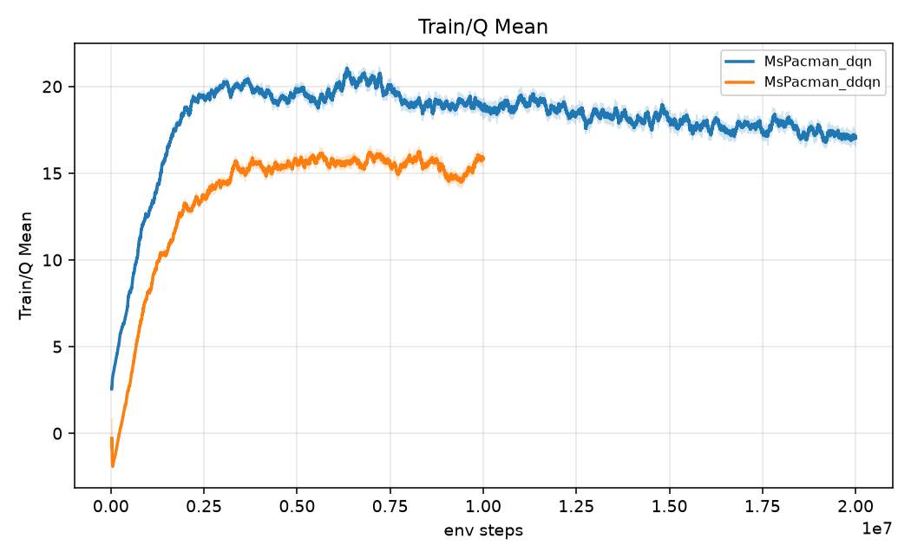

# RL Lab 2 — Deep Q-Network on Atari

強化學習課程 Lab 2：在 Atari `MsPacman-v5` 與 `Enduro-v5` 上實作 DQN，以及三種延伸：

- **Double DQN**：online 網路選動作、target 網路估值，減少 Q 值高估
- **Dueling DQN**：把 Q 拆成狀態價值 V(s) 與動作優勢 A(s,a)
- **Parallelized rollout**：8 個 `AsyncVectorEnv` 同時收集資料

以助教範例程式碼為基礎，使用 PyTorch + Gymnasium，在 RTX 2080 Ti 上訓練。

📄 完整報告：[report.pdf](report.pdf)（Markdown 版：[report.md](report.md)）

## 結果

| 實驗 | 環境 | 步數 | 耗時 | 最佳評估 | 測試平均（5 場） | 測試單場最高 |
|---|---|---|---|---|---|---|
| DQN | MsPacman | 20M | 17.5 h | 4044 | 2954 | 4960 |
| DQN | Enduro | 10M | 12.8 h | 1142 | 948.8 | 1094 |
| DDQN | MsPacman | 10M | 11.3 h | 3444 | **3502** | **5050** |
| Dueling DQN | MsPacman | 10M | 12.7 h | 2286 | 2072 | 2270 |
| DQN（8 envs） | MsPacman | 10M | 7.4 h | 2848 | 1580 | 2530 |

- 「最佳評估」是訓練中每 100k 步、5 場評估（ε = 0.01）的最高平均分；「測試」是訓練結束後用 `best.pt` 以 seed 0–4 重跑 5 場。
- **DDQN 在 MsPacman 上表現最好**：達到 2000、3000 分所需的步數約為 DQN 的一半，Q 值也比 DQN 低約 20%。
- Dueling 前期學得較快，但約 4M 步後停在較低的分數。
- 平行化 rollout 主要省下的是牆鐘時間（10M 步 7.4 h，單環境約 11.1 h），樣本效率沒有提升。
- 每種方法只跑一個 seed，評估雜訊大，結論應視為趨勢而非定論。

| DQN vs DDQN（評估分數） | DQN vs DDQN（Q 值） |
|---|---|
|  |  |

各實驗的詳細數據見 [RESULTS.md](RESULTS.md)，討論見報告第 4–6 節。

## 專案結構

```
.
├── src/                 我的實作（說明見 src/README.md）
│   ├── main.py              訓練入口
│   ├── test.py              用 checkpoint 測試並輸出分數表
│   ├── dqn_agent_atari.py   epsilon-greedy 與各變體的 TD target
│   ├── base_agent.py        訓練迴圈、評估、checkpoint、平行 rollout
│   ├── atari_wrappers.py    環境前處理（灰階、84×84、frame stack、frame skip）
│   ├── models/              Nature DQN 與 Dueling 網路
│   ├── replay_buffer/       以 uint8 單幀儲存的 replay buffer
│   ├── tests/               單元測試
│   └── scripts/             批次訓練、監看、匯出曲線、打包
├── lab2-code/Question/  助教提供的範例程式碼（原始版本）
├── figures/             報告用的訓練曲線
├── screenshot/          5 組實驗的測試結果截圖
├── report.md / .tex / .pdf
├── RESULTS.md           自動產生的實驗數據
└── DECISIONS.md         實作過程中的設計決定與理由
```

助教範例中每個 `TODO` 的實作位置，對照表在 [src/README.md](src/README.md#助教範例程式碼-todo-對照表)。

## 快速開始

```bash
python -m venv .venv
source .venv/bin/activate          # Windows: .venv\Scripts\activate
pip install torch --index-url https://download.pytorch.org/whl/cu124
pip install "gymnasium[atari,other]" ale-py opencv-python tensorboard numpy \
            moviepy imageio-ffmpeg pandas matplotlib psutil pytest
```

測試環境：Python 3.11、torch 2.6.0+cu124、gymnasium 1.4.0、ale-py 0.12.1。

```bash
cd src

# 訓練
python main.py --env ALE/MsPacman-v5 --variant ddqn --training-steps 10000000

# 測試
python test.py --checkpoint ../checkpoints/MsPacman_ddqn/best.pt --episodes 5 --seed 0

# 單元測試
python -m pytest tests -q
```

`--variant` 可選 `dqn`、`ddqn`、`dueling`、`dueling_ddqn`；`--num-envs 8` 開啟平行 rollout。所有參數說明見 [src/README.md](src/README.md)。

> 模型權重沒有放在這個 repo，`checkpoints/` 需要自己訓練產生。

## References

1. Mnih et al. "Human-level control through deep reinforcement learning." *Nature* 518, 2015.
2. van Hasselt, Guez, Silver. "Deep Reinforcement Learning with Double Q-Learning." AAAI, 2016.
3. Wang et al. "Dueling Network Architectures for Deep Reinforcement Learning." ICML, 2016.
