# Lab 2: Deep Q-Network (DQN) — 實驗報告

---

## 1. 實作概要

### 1.1 環境前處理（Atari 常用技巧）

| 技巧 | 設定 | 說明 |
|---|---|---|
| Frame skip | 4（`gym.make(frameskip=1)` + `AtariPreprocessing(frame_skip=4)`） | 只跳一次，避免 v5 預設的 frameskip 與 wrapper 疊成 16 |
| Max-pooling | 取最後兩幀逐像素 max | 消除 Atari 精靈閃爍 |
| Grayscale + Resize | 210×160×3 → 84×84×1 | 降低輸入維度 |
| Frame stack | 4 幀 | 讓網路從靜態影像推出速度與方向 |
| Reward clipping | 訓練用 reward 裁到 [-1, 1] | 只影響寫入 replay buffer 的值；TensorBoard 記錄的是原始分數 |
| Sticky actions | 0.25（v5 預設） | 保留官方 benchmark 設定 |

### 1.2 網路架構

使用 DeepMind Nature DQN：

```
Input (4, 84, 84) /255
→ Conv(32, 8×8, s4) → ReLU → Conv(64, 4×4, s2) → ReLU → Conv(64, 3×3, s1) → ReLU
→ Flatten(3136) → FC(512) → ReLU → FC(|A|)
```

Dueling DQN 共用同樣的卷積層，把最後的全連接層拆成兩支：

```
V(s):    FC(512) → ReLU → FC(1)
A(s,a):  FC(512) → ReLU → FC(|A|)
Q(s,a) = V(s) + ( A(s,a) − mean_a' A(s,a') )
```

### 1.3 DQN 更新流程

- **Epsilon-greedy**：以機率 ε 隨機選動作，否則取 `argmax_a Q(s,a;θ)`。ε 在前 1M 步從 1.0 線性降到 0.1，直接由步數算出，不逐步遞減。
- **Experience replay**：容量 100,000。每個 transition 只存一張 84×84 uint8 影格，抽樣時再依索引重建 4 幀堆疊，記憶體約 0.7 GB（直接存 state/next_state 約 5.6 GB）。
- **Q 值與 target**（`src/dqn_agent_atari.py`）：

```python
q_value = self.behavior_net(state).gather(1, action.unsqueeze(1)).squeeze(1)
with torch.no_grad():
    if self.double:   # DDQN：online 網路選動作、target 網路估值
        next_action = self.behavior_net(next_state).argmax(dim=1, keepdim=True)
        q_next = self.target_net(next_state).gather(1, next_action).squeeze(1)
    else:             # DQN：target 網路同時選動作和估值
        q_next = self.target_net(next_state).max(dim=1).values
    q_target = reward + self.gamma * q_next * (1.0 - done)
loss = self.criterion(q_value, q_target)   # MSE，與講義虛擬碼一致
```

- **網路更新**：每 4 個 env step 對 behavior network 做一次梯度下降（Adam），每 10,000 步把 behavior network 的權重複製到 target network。
- `done` 只在遊戲真正結束（terminated）時為 1。因時間上限被截斷（truncated）的 episode 仍會 bootstrap，因為最後的狀態不是終止狀態。

### 1.4 超參數

| 參數 | 值 |
|---|---|
| Replay buffer 容量 | 100,000 |
| Batch size | 32 |
| Warmup steps | 20,000 |
| Optimizer | Adam（lr = 6.25e-5，eps = 1.5e-4） |
| Epsilon | 1.0 → 0.1（線性，1M 步） |
| Gamma | 0.99 |
| Behavior network 更新頻率 | 每 4 步 |
| Target network 更新頻率 | 每 10,000 步 |
| Loss | MSE |
| Gradient norm clipping | 10.0 |
| 評估 | 每 100k 步評估 5 場完整遊戲，ε = 0.01，固定 seed 10000–10004 |
| 測試 | 用 `best.pt` 跑 5 場完整遊戲，ε = 0.01，seed 0–4 |

五組實驗都用 seed 0，每組相對 DQN baseline 只改一個條件。五組在同一張 RTX 2080 Ti 上同時訓練。

> 圖中淡色線是原始數值，實線是 TensorBoard 相同算法的 EMA 平滑（weight 0.9）。x 軸是累積 env steps；平行化 rollout 的步數是 8 個環境的總和。

---

## 2. DQN — MsPacman-v5

訓練 20M env steps，耗時 17.5 小時。

### 2.1 Training curve

| Train/Episode Reward | Evaluate/Episode Reward |
|---|---|
| 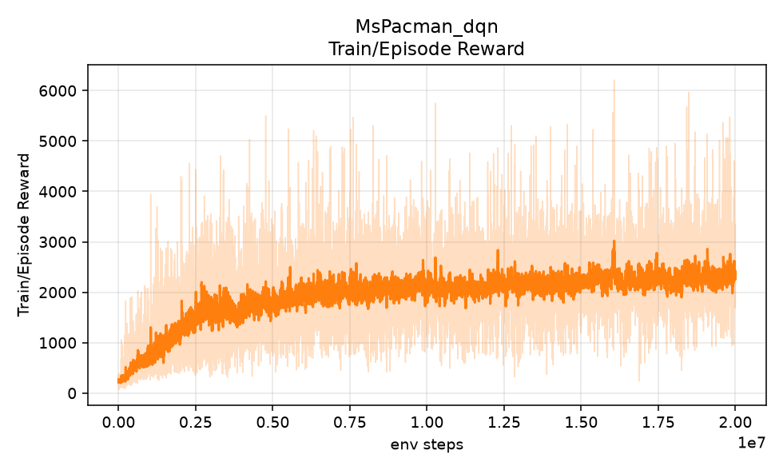 | 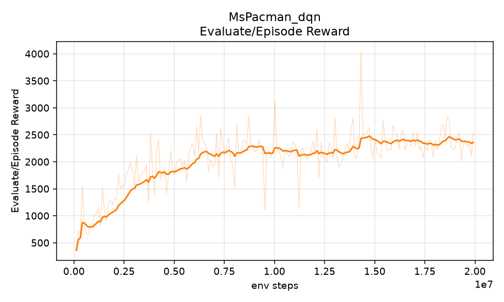 |

| Train/Q Mean | Train/Loss |
|---|---|
| 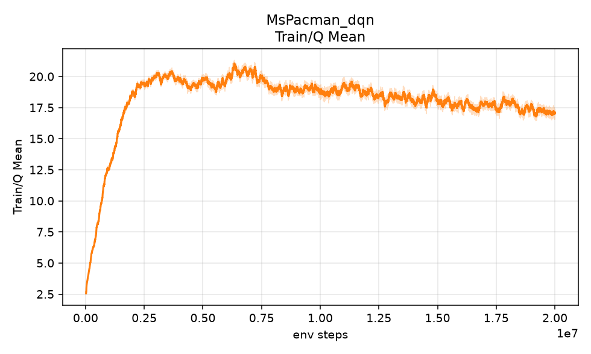 | 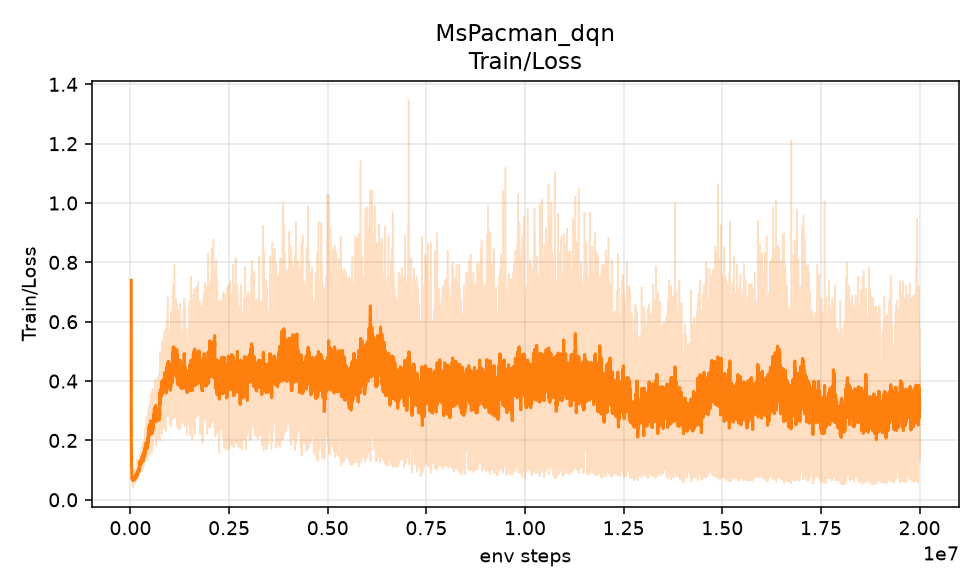 |

### 2.2 Testing results（5 games）

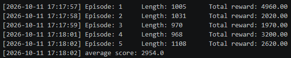

```
Episode: 1     Length: 1005      Total reward: 4960.00
Episode: 2     Length: 1031      Total reward: 2020.00
Episode: 3     Length: 970       Total reward: 1970.00
Episode: 4     Length: 968       Total reward: 3200.00
Episode: 5     Length: 1108      Total reward: 2620.00
average score: 2954.0
```

### 2.3 觀察

- **學習速度**：評估分數 0.42M 步第一次超過 1000，3.12M 步超過 2000，之後成長明顯變慢。各區間的評估平均：0–2M 為 967，2–5M 為 1778，5–10M 為 2178，10–20M 為 2317。
- **後半段幾乎停滯**：後 10M 步的平均只比前一段多約 140 分。單次最高評估 4044 出現在 14.32M 步，但平滑曲線在那段只有 ~2400，屬於 5 場評估的雜訊尖峰。最後一次評估（19.92M 步）是 2548。
- **`best.pt` 的選擇偏差**：`best.pt` 是評估平均最高（4044）的那個 checkpoint，但換 seed 測試只得 2954。用單次 5 場的最高值挑模型，會偏向挑到運氣好的那一次。
- **Q 值**：Train/Q Mean 在 ~2.5M 步升到約 20，之後在 10–20M 步緩慢降到約 17。這裡的 Q 是在 clipped reward 尺度下。

---

## 3. DQN — Enduro-v5

訓練 10M env steps，耗時 12.8 小時。

### 3.1 Training curve

| Train/Episode Reward | Evaluate/Episode Reward |
|---|---|
| 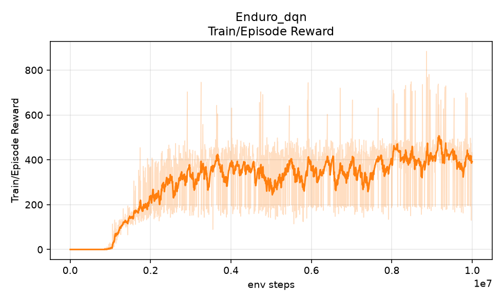 | 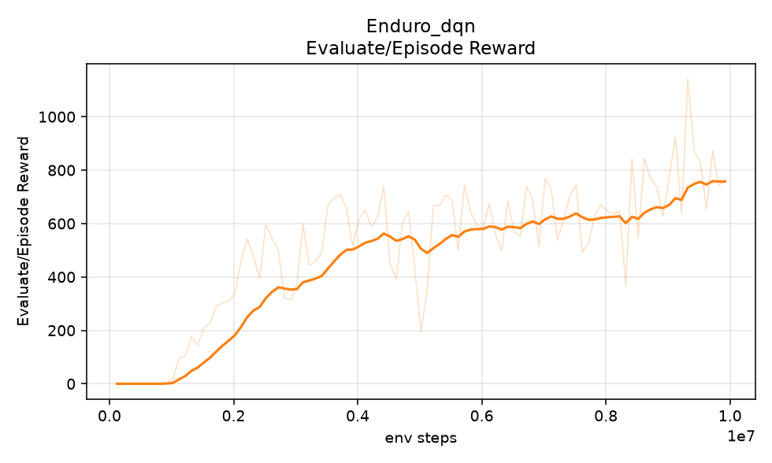 |

### 3.2 Testing results（5 games）

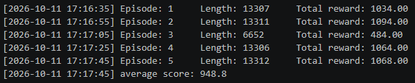

```
Episode: 1     Length: 13307     Total reward: 1034.00
Episode: 2     Length: 13311     Total reward: 1094.00
Episode: 3     Length: 6652      Total reward: 484.00
Episode: 4     Length: 13306     Total reward: 1064.00
Episode: 5     Length: 13312     Total reward: 1068.00
average score: 948.8
```

### 3.3 觀察

- **前 ~1M 步 reward 幾乎都是 0**：Enduro 要超車才會得分，而前 1M 步 ε 還在從 1.0 往下降，隨機動作很難持續加速並超車，所以 agent 長時間拿不到非零的回饋。ε 降低、agent 開始穩定前進後，reward 在 1–2M 步之間快速上升。
- **還沒收斂**：評估平均在 5–10M 步是 662，最後 1M 步是 821。最佳評估 1142 出現在 9.32M 步，接近訓練結束，曲線仍在上升，再多訓練應該還會進步。
- **測試**：5 場中有 4 場打完約 13,300 步、分數在 1030–1090。第 3 場只有一半長度、分數也只有一半（484），推測是某一天沒達到超車門檻，遊戲提前結束。

---

## 4. DDQN vs DQN

DDQN 只改 target 的計算：`y = r + γ · Q_target(s', argmax_a' Q_online(s', a'))`，網路與其他設定都和 DQN 相同。訓練 10M 步。

### 4.1 Training curve（comparison）

| Evaluate/Episode Reward | Train/Episode Reward |
|---|---|
|  | 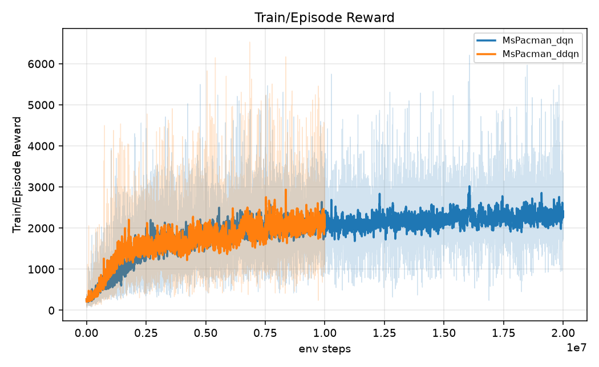 |


### 4.2 Testing results（5 games）

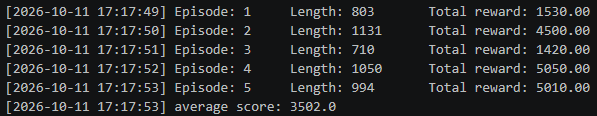

```
Episode: 1     Length: 803       Total reward: 1530.00
Episode: 2     Length: 1131      Total reward: 4500.00
Episode: 3     Length: 710       Total reward: 1420.00
Episode: 4     Length: 1050      Total reward: 5050.00
Episode: 5     Length: 994       Total reward: 5010.00
average score: 3502.0
```

### 4.3 比較（同樣 10M 步內）

| 指標 | DQN | DDQN |
|---|---|---|
| 評估平均，5–10M 步 | 2178 | **2284** |
| 評估平均，9–10M 步 | 2106 | **2451** |
| 最佳評估（≤10M） | 2866 | **3444** |
| 第一次評估 ≥ 2000 | 3.12M 步 | **1.32M 步** |
| 第一次評估 ≥ 3000 | 10.02M 步 | **5.32M 步** |
| Train/Q Mean，5–10M 步 | 19.5 | **15.5** |
| `best.pt` 測試平均（seed 0–4） | 2954（20M 步的模型） | **3502** |
| 51 個 seed 中單場 > 3000 的數量 | 10 / 51（20M 步的模型） | **25 / 51** |

### 4.4 討論

- **Over-estimation**：DQN 的 target `max_a' Q_target(s', a')` 用同一個網路選動作又估值。Q 的估計有雜訊時，取 max 會偏向剛好被高估的動作，所以 target 系統性偏高，而且這個偏差會透過 bootstrap 一路傳下去。DDQN 讓 online 網路選動作、target 網路估值，選擇和評估的雜訊不再是同一份，max 帶來的正向偏差因此變小。
- **實驗結果與此一致**：DDQN 的 Q 值在整段訓練都比 DQN 低約 4（5–10M 步 15.5 vs 19.5，約低 20%）。DQN 的 Q 值在 ~6M 步達到約 21 後逐步下降，DDQN 則一直穩定在 15–16。不過要注意，Dueling DQN 用的是 DQN target，它的 Q 值卻也在 15.5 左右（見第 5 節），所以兩者 Q 值的差距不能全部歸因於 over-estimation。要直接證明高估，需要把 Q 和實際的折扣回報比較，這次沒有量。
- **表現**：DDQN 達到 2000 和 3000 分所需的步數都只有 DQN 的一半左右，10M 步內的最佳評估也高出約 580。最終模型在 demo 上也最穩：51 個 seed 中有一半單場超過 3000，DQN 只有五分之一。
- **限制**：每種方法只跑了一個 seed，單次評估的標準差在 600–1400 之間，DQN 與 DDQN 的平滑曲線在 3–8M 步之間有很長一段幾乎重疊。這些差距符合理論預期，但不能視為統計上確定的結論。

---

## 5. Dueling DQN vs DQN

Dueling DQN 只改網路架構（見 1.2），target 仍是 DQN 的寫法。訓練 10M 步。

### 5.1 Training curve（comparison）

| Evaluate/Episode Reward | Train/Episode Reward |
|---|---|
| 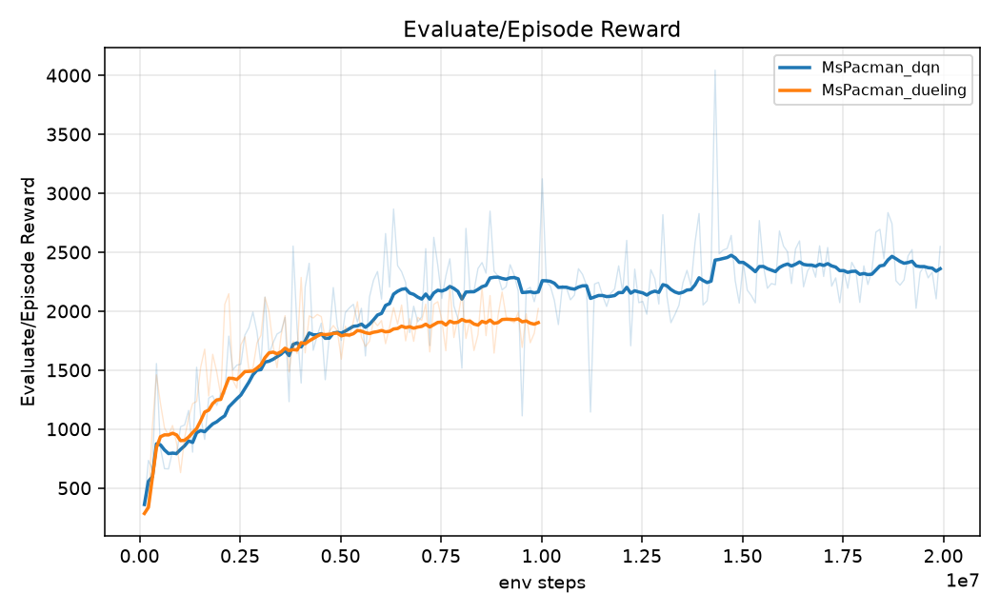 | 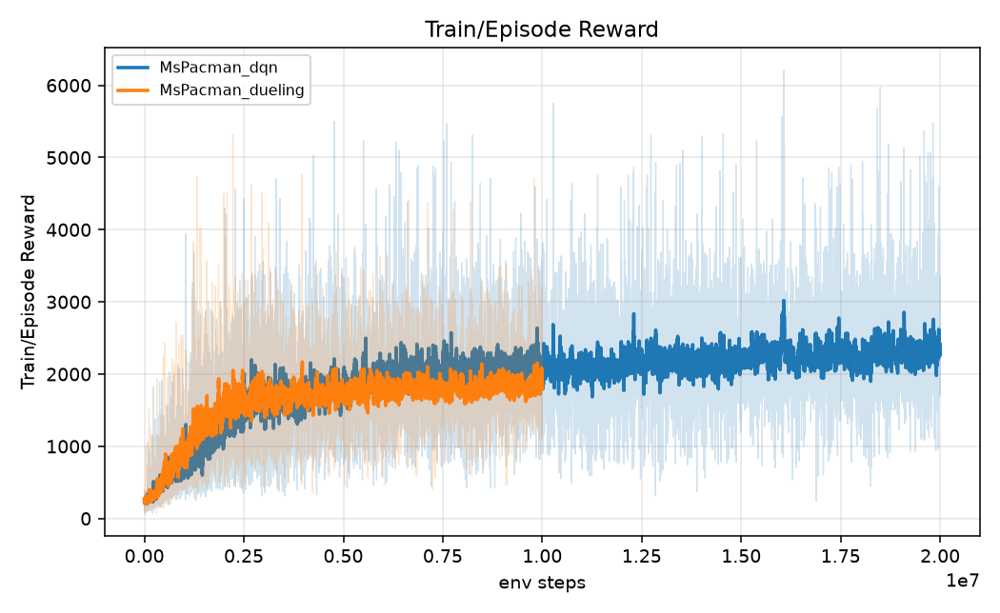 |

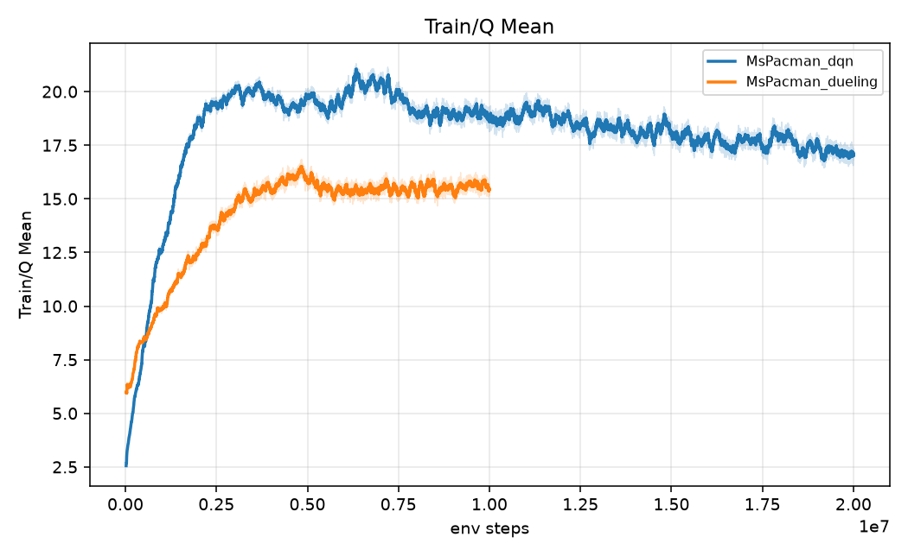

### 5.2 Testing results（5 games）

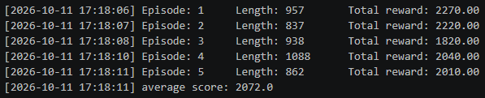

```
Episode: 1     Length: 957       Total reward: 2270.00
Episode: 2     Length: 837       Total reward: 2220.00
Episode: 3     Length: 938       Total reward: 1820.00
Episode: 4     Length: 1088      Total reward: 2040.00
Episode: 5     Length: 862       Total reward: 2010.00
average score: 2072.0
```

### 5.3 比較（同樣 10M 步內）

| 指標 | DQN | Dueling |
|---|---|---|
| 評估平均，0–2M 步 | 967 | **1102** |
| 第一次評估 ≥ 1000 | 0.42M 步 | **0.32M 步** |
| 評估平均，2–5M 步 | 1778 | 1777 |
| 評估平均，5–10M 步 | **2178** | 1892 |
| 最佳評估（≤10M） | **2866** | 2286（4.02M 步） |
| Train/Q Mean，5–10M 步 | 19.5 | 15.5 |
| `best.pt` 測試平均（seed 0–4） | **2954**（20M 步的模型） | 2072 |
| 模型大小 | 27 MB | 53 MB |

### 5.4 討論

- **架構差異**：Dueling 把 Q 拆成狀態價值 V(s) 和動作優勢 A(s,a)。在 MsPacman 裡，很多狀態（例如在直線走道、附近沒有鬼）不管選哪個動作，結果都差不多。DQN 每次更新只修正被選到的那一個 Q(s,a)，Dueling 則每次都會更新共用的 V(s)，所以狀態價值學得比較快，需要學的也只剩動作之間的相對差異。減掉 advantage 的平均是為了讓 V 和 A 可以唯一分解，否則常數可以在兩者之間任意移動。
- **前期學得較快**：這和上面的說法一致。Dueling 是三者中最早到 1000 分的（0.32M 步），0–2M 步的評估平均也比 DQN 高約 135。
- **後期停在較低的水準**：從 ~4M 步開始，Dueling 的評估平均就停在 ~1900 左右，最佳評估 2286 出現在 4.02M 步，後面 6M 步都沒有再超過。DQN 則繼續升到 ~2200。可能的原因：
  1. 全連接層從一支變兩支，參數幾乎多了一倍（53 MB vs 27 MB），但學習率和 gradient clipping 都沿用 DQN 的設定。原論文會把回傳到卷積層的梯度乘上 1/√2，並調整學習率，這次沒有做。
  2. 只跑一個 seed，前期優勢和後期劣勢都可能在 seed 變異的範圍內。
- **Q 值**：Dueling 的 Q 值也穩定在 15.5 左右，比 DQN 低，跟 DDQN 差不多，但它用的是 DQN target。這表示網路架構本身也會改變 Q 值的大小，所以不能只看 Q 值高低就判斷高估的程度。

---

## 6. DQN with parallelized rollout vs DQN

用 8 個 `AsyncVectorEnv` 環境同時收集資料，演算法與超參數完全不變：

- 每 4 個 env step（8 個環境的總和）一次梯度更新，所以兩者在同樣 env steps 下的梯度更新次數相同。
- Replay buffer 總容量仍是 100,000，切成 8 段、每段 12,500，每個環境寫自己那段，避免不同 episode 的影格交錯、破壞 frame stack。
- Target network 同步改用計數器判斷是否跨過 10,000 步，因為步數一次跳 8，用 `step % 10000 == 0` 可能永遠不會觸發。

訓練 10M 步。

### 6.1 Training curve（comparison）

以 env steps 為 x 軸（樣本效率）：

| Evaluate/Episode Reward | Train/Episode Reward |
|---|---|
| 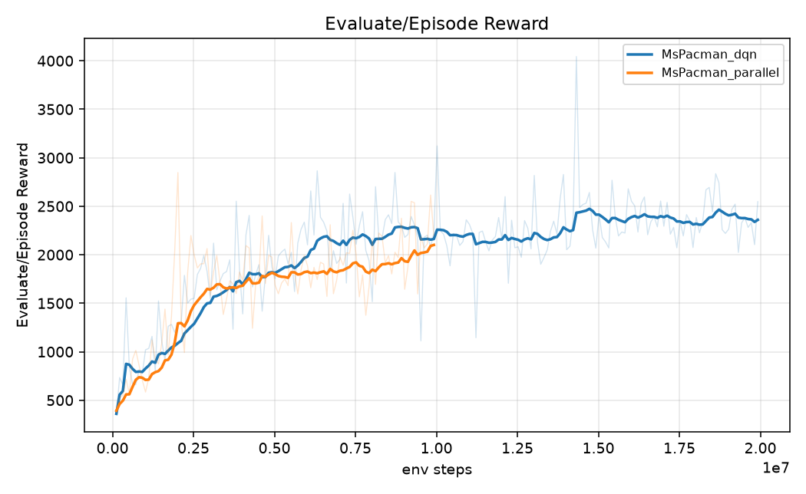 | 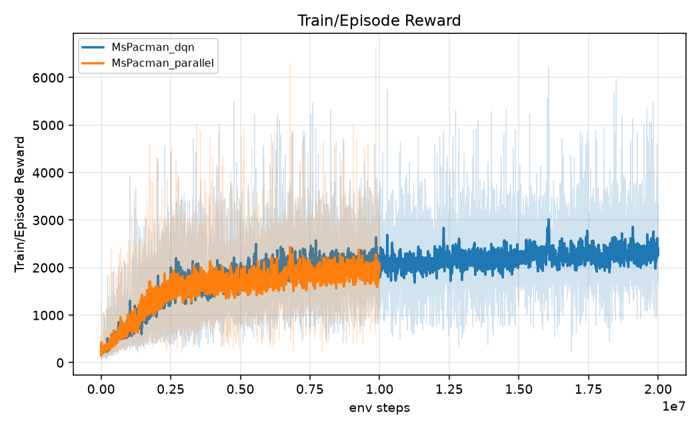 |

以 wall-clock 時間為 x 軸（實際花費時間）：

| Evaluate/Episode Reward（wall-clock） | Perf/Steps Per Second |
|---|---|
| 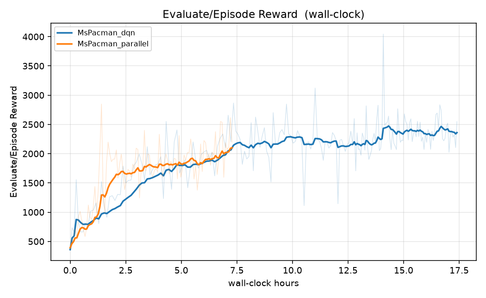 | 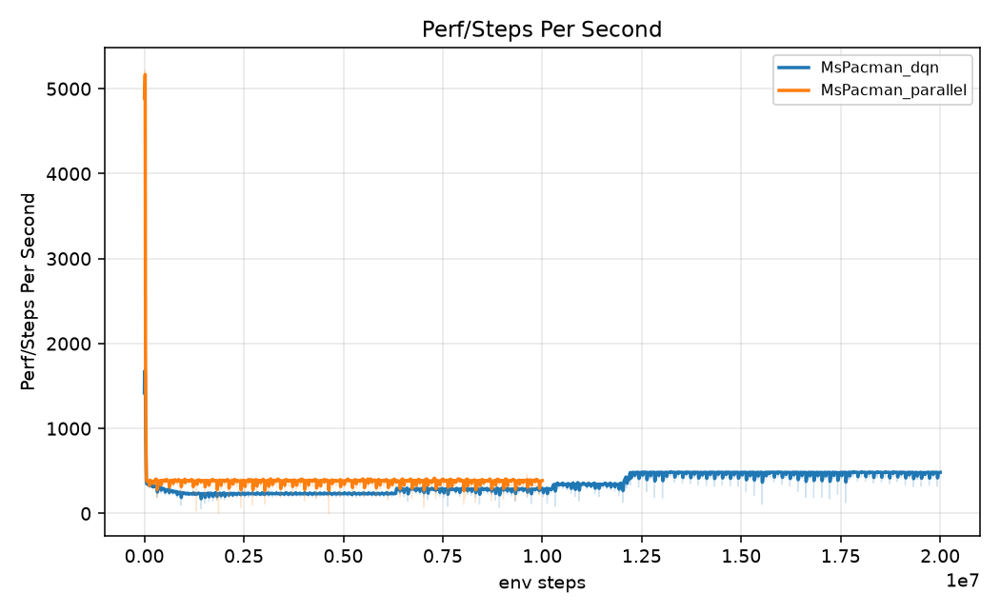 |

### 6.2 Testing results（5 games）

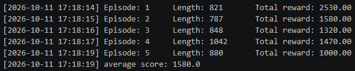

```
Episode: 1     Length: 821       Total reward: 2530.00
Episode: 2     Length: 787       Total reward: 1580.00
Episode: 3     Length: 848       Total reward: 1320.00
Episode: 4     Length: 1042      Total reward: 1470.00
Episode: 5     Length: 880       Total reward: 1000.00
average score: 1580.0
```

### 6.3 比較

| 指標 | DQN（1 env） | Parallel（8 envs） |
|---|---|---|
| 吞吐量（五組同時訓練） | 316 步/秒 | **374 步/秒**（1.18×） |
| 吞吐量（單獨跑，50k 步 smoke test） | ~560 步/秒 | **~725 步/秒**（~1.3×） |
| 跑完 10M 步的時間 | ~11.1 h | **7.4 h** |
| 第一次評估 ≥ 2000 | 3.12M 步 / 3.55 h | 1.92M 步 / **1.41 h** |
| 評估平均，5–10M 步 | **2178** | 1930 |
| 評估平均，9–10M 步 | 2106 | **2138** |
| 最佳評估（≤10M） | **2866** | 2848（2.02M 步） |
| `best.pt` 測試平均（seed 0–4） | **2954**（20M 步的模型） | 1580 |

### 6.4 討論

- **主要差異是牆鐘時間**：DQN 單環境時，每一步都要依序做「環境模擬 → 網路推論 → 存入 buffer」。平行化後，8 個環境在不同 process 同時模擬，推論也合成一個 batch，平均到每步的成本就降低了。在同樣的 7.4 小時內，平行化版本跑完 10M 步，單環境版本只跑到約 6.3M 步。以時間為 x 軸時，平行化曲線在 1–4 小時之間明顯領先，例如 1.41 小時就到 2000 分，DQN 要 3.55 小時。
- **加速遠不到 8 倍**：因為我們保持「每 4 個 env step 一次更新」，梯度更新的次數只和總步數有關，與環境數量無關。平行化只加速了資料收集，梯度更新（batch 32 的前向、反向傳播）一點都沒變少。加上這次五組實驗共用一張 GPU（使用率 ~98%），GPU 才是瓶頸，所以加速比從單獨跑的 ~1.3× 進一步縮小到 1.18×。
- **樣本效率略差或相當**：用 env steps 比較時，兩條曲線大致重疊。5–10M 步的平均平行化低約 250，但最後 1M 步兩者相當（2138 vs 2106）。平行化時，8 個環境在同一組參數下各跑 8 步之後才會再更新，資料和當前 policy 的距離稍微大一點，這可能讓樣本效率略低。
- **測試分數偏低的原因**：平行化版本的最佳評估（2848）出現在很早的 2.02M 步，是一次雜訊尖峰，所以 `best.pt` 其實是一個只訓練 2M 步的模型，換 seed 測試只剩 1580。從評估曲線看，平行化版本在 9–10M 步的表現（~2140）比 `best.pt` 還好。這是「用單次 5 場評估挑 checkpoint」的問題，和平行化本身無關。

---

## 7. 總結

| 實驗 | 環境 | 步數 | 耗時 | 最佳評估 | 測試平均（5 場） | 測試單場最高 |
|---|---|---|---|---|---|---|
| DQN | MsPacman | 20M | 17.5 h | 4044 | 2954 | 4960 |
| DQN | Enduro | 10M | 12.8 h | 1142 | 948.8 | 1094 |
| DDQN | MsPacman | 10M | 11.3 h | 3444 | **3502** | **5050** |
| Dueling DQN | MsPacman | 10M | 12.7 h | 2286 | 2072 | 2270 |
| DQN（8 envs） | MsPacman | 10M | 7.4 h | 2848 | 1580 | 2530 |

- 在這次的設定中，**DDQN 是 MsPacman 上表現最好的方法**：只用 DQN 一半的步數，測試平均和穩定度都比較好。
- Dueling 前期學得較快，但後期停在較低的分數。平行化 rollout 主要節省的是牆鐘時間，不提升樣本效率。
- 所有比較都只有一個 seed，且評估雜訊大（單次 5 場的標準差 600–1400），結論應視為趨勢而非定論。

### Demo 模型

用 `find_best_seed.py` 掃描 seed 0–50 後，demo 選用 **`MsPacman_ddqn/best.pt`，seed 18，單場 5310 分**。同一個 checkpoint 和同一個 seed 會重現完全相同的遊戲（ALE reset、sticky actions、隨機 no-op、epsilon 擲骰都由同一個 seed 決定）。

```bash
cd src
python test.py --checkpoint ../checkpoints/MsPacman_ddqn/best.pt --seeds 18 --episodes 1 --record-video
```

---

## References

1. Mnih et al. "Playing Atari with Deep Reinforcement Learning." arXiv:1312.5602, 2013.
2. Mnih et al. "Human-level control through deep reinforcement learning." *Nature* 518, 2015.
3. van Hasselt, Guez, Silver. "Deep Reinforcement Learning with Double Q-Learning." AAAI, 2016.
4. Wang et al. "Dueling Network Architectures for Deep Reinforcement Learning." ICML, 2016.
